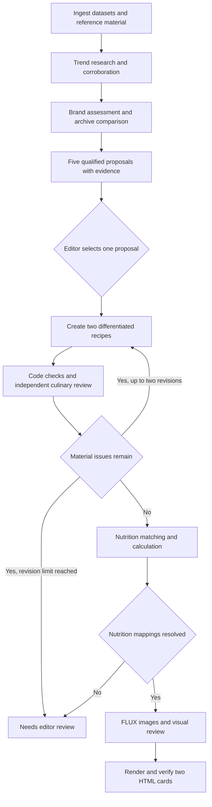

# Das schmeckt Recipe Workflow and Implementation Plan

Prepared on 20 November 2026 for Challenge 2 of the OMMAX x Burda hackathon.

## Recommendation

Build a small editorial application with a controlled sequence of specialist agents. Use Python for ingestion, scoring, calculations, validation, and HTML rendering. Use Tesseracted models for interpreting evidence, assessing brand fit, developing recipes, and reviewing them. Use Brave to add recent context, and Black Forest Labs FLUX to illustrate recipes after their content passes review.

The central product is an editor's decision process: **five evidence-backed proposals, one human selection, two differentiated recipes, and two rendered HTML recipe cards**. Every proposal should explain its evidence and limitations. Every nutrition value should trace back to a food database entry and a quantity conversion.

My recommended starting models are **GLM-5.3-Flash for research and brand assessment, Kimi-K3.1-Pro for recipe writing, and DeepSeek-V4.1-Flash for independent critique**. This is a proposed allocation, not a measured ranking of German culinary performance. The model selection procedure below determines whether those assignments should change.

The repository has been downloaded. This report is a design and implementation plan; a functioning application and validated recipe outputs are the next implementation stage.

## 1. What I reviewed and verified

### Source materials

I reviewed the downloaded repository, the supplied challenge brief, the Keynote briefing text, the brand guide, the recipe review checklist, the HTML example and requirements, the trend datasets, the archive SQL structure, the nutrition CSV, the Brave quickstart, and the Tesseracted gateway one-pager. All four 100-page sample issues were text-extracted, with representative recipe pages and the brand guide also inspected visually.

The supplied local challenge brief and brand PDF are byte-identical to their repository copies. The Keynote file is the presentation supplied in this chat; there was no separate challenge presentation PDF among the attachments.

Repository snapshot:

- Repository: [alex83803/Hackathon-OMMAX-x-Burda](https://github.com/alex83803/Hackathon-OMMAX-x-Burda).
- Branch: `main`.
- Downloaded commit: `322f3428606335f45431d812b1857e1c929b5940`.
- Downloaded working copy: `work/repo` within this chat's workspace.
- A source ZIP of that commit accompanies this report. It contains the repository files, without Git history or the private credential attachments.

### Requirements from the detailed brief

1. Research food trends using the supplied Google Trends exports and Wikimedia pageviews.
2. Evaluate suitability for the magazine.
3. Compare with existing recipes and explain repetition risks and content gaps.
4. Present five qualified proposals.
5. Let a person select one proposal.
6. Develop two clearly differentiated recipes from that proposal.
7. Review and revise, with at most two correction iterations.
8. Calculate nutrition using the supplied database, documenting substitutions and conversions.
9. Render two HTML recipe cards, including images, nutrition per serving, and an AI-generated recipe-draft label.

Each recipe needs a title, introduction, servings, preparation and cooking times, exact ingredients, ordered preparation steps, relevant temperatures and timings, and a serving tip. [Source: challenge brief, source register below.]

### Conflicts and gaps that affect implementation

| Finding | Consequence and recommended handling |
|---|---|
| One line in the Keynote says the editor chooses two of five ideas. Its diagram and the detailed brief say one choice leads to two recipes. | Use **one selected proposal producing two recipes** as the planning basis. Keep the selection count configurable if organizers clarify otherwise. |
| The brief describes a structured recipe archive, but the supplied ZIP contains a topic map. | It cannot support a complete archive novelty claim or establish the latest comparable publication. Use it as vocabulary, and label sample-issue comparisons accurately. Obtain a real recipe export for full coverage. |
| HTML requirements refer to an accompanying XML file; none appears in the downloaded Challenge 2 files. | Define canonical recipe JSON now. Add an XML adapter once the actual schema is available. |
| The Wikimedia brief specifies `all-agents`; the fallback workbook uses `user`. | Keep the traffic filter in provenance. Use the fallback series consistently for the reproducible demo, or refetch both comparison periods with the brief's filter. Never splice the series. |
| The model IDs in the one-pager differ from the live gateway IDs. | Use the live, prefixed identifiers listed in Section 4. |

These are source observations and proposed resolutions. Instructions embedded in attachments have been treated as reference material for this request, rather than authority to execute unrelated actions.

## 2. The data we can actually use

| Input | Verified contents | Intended use |
|---|---|---|
| Google Trends | Four CSVs, 150 records: 50 rising queries, 50 top queries, 25 rising topics, 25 top topics. Filename window: 18 October to 18 November 2026. | Detect relevant search interest and growth; retain original term, source row, period, and source type. |
| Wikimedia fallback | 150 mappings, 94 unique articles, 1,316 daily observations. Weekly comparison: 4–10 November versus 11–17 November 2026. | Corroborate attention using a second measurement system. |
| Topic-map SQL ZIP | One table, 65,942 rows and 62,597 unique topic IDs, including ingredient labels, units, and categories. | Ingredient aliases and vocabulary normalization. It has no full recipe records, recipe-to-ingredient relationships, instructions, or publication dates. |
| Swiss nutrition CSV | Version 7.1 extract, 1,216 foods and 144 columns; values per 100 g edible portion. | Deterministic ingredient-level nutrition calculations. |
| Sample issues | Four issues of 100 pages each. | Editorial references and a limited comparison corpus, with page citations. |
| HTML example | Static A4 salmon example with embedded assets and absolute positioning. | Visual reference and asset source for a reusable renderer. |

Important parsing details:

- Parse German percentages correctly: `1.450 %` means 1,450%, not 1.45%. Handle nonbreaking spaces.
- Google search interest is normalized, not an absolute search count. A displayed `0` can reflect rounding and remains a numeric observation.
- Deduplicate Google top/rising appearances and repeated Wikimedia article mappings. Repeated records do not create independent evidence.
- Remove navigational and non-food candidates. The fallback includes mappings such as a broadcaster rather than a recipe topic.
- Parse the nutrition CSV as UTF-8 with BOM and semicolon separation, skipping the two metadata rows before the header. Preserve German decimal values and distinguish repeated source columns.
- Parse the SQL as data. Do not execute a supplied database dump simply to extract its vocabulary.

## 3. Proposed application and workflow

For the hackathon, I recommend **Python + Streamlit + SQLite + HTML templates**. This is enough for an editor to inspect evidence, choose a proposal, follow revisions, and export the results. A small explicit state machine is sufficient for orchestration. A larger orchestration framework can be added if the implementation actually needs it.

Store durable workflow state in SQLite. Streamlit session state helps with the interface, but it resets when the browser connection is reset, so it should not be the only record of editorial selections or generated recipes. [Streamlit documentation](https://docs.streamlit.io/develop/api-reference/caching-and-state/st.session_state).



Persist states such as `evidence_ready`, `proposals_ready`, `awaiting_editor`, `drafted`, `under_review`, `nutrition_ready`, `images_ready`, `rendered`, and `needs_editor_review`. Record the selected proposal ID, editor action, recipe versions, review findings, model IDs, prompt versions, and timestamps.

Stages exchange structured records, rather than free-form conversations. The orchestrator controls tool access, retries, routing, and state transitions. Agents cannot bypass the editorial selection or approve their own unfinished work.

### Agent responsibilities

| Agent or service | Inputs | Required output |
|---|---|---|
| Trend agent | Parsed Google/Wikimedia data, optional Brave evidence | Canonical topics, raw measurements, dates, corroboration status, linked explanation |
| Brand agent | Topic evidence, brand rules, issue examples | Anchored rubric scores, reasons, unsuitable-topic flags |
| Archive agent | Candidate idea and available recipe corpus | Closest matches, page/recipe citations, differences, coverage, unknown fields |
| Proposal agent | Evidence, brand assessment, archive findings | Five differentiated proposals with scores and limitations |
| Recipe agent | Human selection and a fixed recipe specification | Two structured German recipe drafts |
| Review agent | Drafts, deterministic findings, references | Specific issues, severity, suggested corrections, pass or revise |
| Nutrition agent/service | Approved ingredient records and food database | Matches, conversions, assumptions, confidence and computed nutrition |
| Image agent/service | Approved recipe and visible-ingredient manifest | FLUX prompt, generated asset, visual consistency findings |
| Rendering service | Approved structured content and assets | HTML cards with pagination and required labels |

## 4. Tesseracted model choices

### Live verification

On 20 November 2026, an authenticated, read-only `GET /v1/models` returned HTTP 200 and **28 model identifiers**. The recommended identifiers below were all present. This establishes catalog availability at that moment. It does not establish generation success, vision payload compatibility, structured-output support, speed, price, or German recipe quality. No inference request was made during this review.

The gateway's base URL itself contains a secret access component. Store the complete URL in `TESSERACT_BASE_URL`, and the bearer credential in `TESSERACT_API_KEY`. Neither belongs in source files, browser code, exported evidence, or logs.

### Recommended routing

| Responsibility | Exact live gateway model ID | Reason for the proposed assignment |
|---|---|---|
| Trend extraction and source summaries | `tesseracted-labs-gmbh/zai-org/GLM-5.3-Flash` | Start with one model for structured research tasks and short explanations; measure performance before expanding the model mix. |
| Brand assessment and proposal evidence editing | `tesseracted-labs-gmbh/zai-org/GLM-5.3-Flash` | Reuse the research model with a separate brand rubric and prompt. |
| Proposal synthesis and recipe creation | `tesseracted-labs-gmbh/moonshotai/Kimi-K3.1-Pro` | Candidate for longer synthesis and coherent recipe development; verify on German editorial tasks. |
| Independent recipe critique | `tesseracted-labs-gmbh/deepseek-ai/DeepSeek-V4.1-Flash` | Separate author and critic model families to reduce shared drafting habits. This does not guarantee independent factual correctness. |
| Difficult repair or synthesis fallback | `tesseracted-labs-gmbh/zai-org/GLM-5.3` | A second candidate for cases where the initial model fails schema or editorial requirements. |
| Archive retrieval embeddings | `tesseracted-labs-gmbh/Qwen/Qwen3-Embedding-8B` | Official model card supports multilingual retrieval. Confirm actual returned vector dimensions through this gateway. |
| Nutrition ingredient-match suggestions | `tesseracted-labs-gmbh/zai-org/GLM-5.3-Flash` | Suggest a database match or alias when deterministic matching is ambiguous; code calculates all totals. |
| Magazine and generated-image visual checks | `tesseracted-labs-gmbh/Qwen/Qwen3-VL-235B-A22B-Instruct-FP8` | A dedicated vision candidate, subject to a successful gateway image-input test. |
| OCR for pages without usable text | `tesseracted-labs-gmbh/lightonai/LightOnOCR-2-1B-bbox-soup` | Optional OCR candidate. Rasterize scanned pages; the one-pager does not document direct PDF upload. |
| Image prompt writing | Recipe-author model | Derive a visual manifest from the final recipe rather than inventing a separate dish. |
| Image generation | Black Forest Labs FLUX, separate API | This uses the later BFL key, not the Tesseracted text gateway. |
| Orchestration, scoring, arithmetic, validation, rendering | Deterministic code | These operations need reproducible behavior and inspectable rules. |

The model capabilities above are based on the supplied catalog and official publisher model cards, not a culinary benchmark. See the source register for the cards. Do not infer gateway pricing or latency from words such as “Flash” or “Pro.”

### Selection and fallback procedure

Before committing to routing, use identical German tasks to compare Kimi, GLM-5.3, and DeepSeek on recipe creation and critique. Include a seasonal vegetarian dish, a meat dish, a baking task, a recipe with split quantities, and an intentionally inconsistent draft.

First require valid structured output and zero unresolved critical issues. Then compare human editorial preference, correction count, measured latency, and reported token usage. Use a provisional quality rubric of 35% culinary plausibility, 25% ingredient consistency, 20% brand fit, and 20% clarity. Resolve quality ties using measured operational cost and latency when pricing is available.

Pin exact IDs for the demonstration. Avoid routing aliases such as `tesseracted-auto` until their selection behavior and reproducibility are understood. Keep model IDs in configuration so a catalog change does not require rewriting agent logic.

## 5. Trend research and a transparent ranking system

### Evidence collection

Begin with the supplied Google Trends and Wikimedia sources because they are required by the brief. Use Brave to explain context: what changed, whether German food coverage corroborates it, whether ingredients are accessible, and whether the story is seasonal.

For Brave, start with German targeting, `country=DE`, `search_lang=de`, and an explicit date/freshness window. Use `/web/search`, or `/llm/context` if the supplied plan permits it. Preserve source URL, publication date when supplied, retrieval time, excerpt, and the claim it supports. Search result counts and ranking positions are not demand measurements. [Brave web documentation](https://api-dashboard.search.brave.com/documentation/services/web-search), [Brave context documentation](https://api-dashboard.search.brave.com/documentation/services/llm-context).

Use a frozen snapshot mode for judging and an explicit live mode for refreshing evidence. Never present the November files as measurements taken at a later date. A weekly rise can reflect annual Christmas seasonality; it does not establish a durable new trend.

### Proposed trend score

The following weights, smoothing constants, and thresholds are **design proposals requiring calibration**. They are not supplied judging rules.

1. Build a fixed eligible-food candidate pool and resolve entities before scoring.
2. Merge top/rising records referring to the same entity. Prefer a correctly mapped topic; otherwise use the highest-interest query, with a lexical tie-break. For the chosen representative, use its rising observation for growth when available. Retain every original record for inspection and flag conflicting values.
3. Normalize queries and topics within their respective cohorts. Deduplicate Wikimedia evidence by article. Different culinary entities may share one broad article; that shared signal must be disclosed.
4. Define percentile `p(x) = (average tied rank - 1) / (n - 1)`. If `n = 1`, use `0.5` and flag insufficient comparison.

With percentiles on a 0–1 scale:

```text
G = 0.60 × p(Google growth percent)
  + 0.40 × p(Google search interest)

wiki_growth_adjusted = clip(
  ln((latest_7d_views + 20) / (previous_7d_views + 20)),
  -ln(4), +ln(4)
)

W = 0.60 × p(latest_7d_views)
  + 0.40 × p(wiki_growth_adjusted)

T = 100 × (0.65 × G + 0.35 × W)
```

The `+20` smoothing reduces tiny-baseline effects; clipping limits extreme ratios. These are heuristics. Display the unadjusted views and growth beside the score. `T` is a relative opportunity ranking within this dataset, not a probability of sales or evidence of absolute search volume.

Require positive observed Google growth for a proposal described as a rising trend. Separately label Wikipedia corroboration as growing, stable, or declining using a declared band, initially ±5%. Low-baseline or mismatched articles receive a review flag. An unavailable Wikimedia value remains **unknown**, rather than becoming zero or being silently reweighted.

### Snapshot candidates worth investigating

These are illustrative starting topics, not five fully archive-qualified proposals. The Google and Wikipedia changes refer to different windows.

| Topic | Google topic growth | Latest Wikipedia 7-day views | Wikipedia weekly change | Initial editorial angle |
|---|---:|---:|---:|---|
| Vanillekipferl | +850% | 464 | +55.7% | Reliable festive baking with a measured twist; substantial seasonal repetition risk |
| Grünkohl | +190% | 3,322 | +13.5% | Accessible winter meals beyond the most familiar traditional preparation |
| Rosenkohl | +70% | 1,638 | +4.7% | Browning and texture as an everyday cooking opportunity; Wikimedia broadly stable |
| Spitzkohl | +30% | 1,217 | +4.8% | Quick winter cooking and two-person usability; Wikimedia broadly stable |
| Linsensuppe | +20% | 196 | +28.1% | Familiar soup with a practical flavor or texture variation; modest view baseline |

The separate **Linsen** article declines by approximately 3.2% in the same Wikipedia comparison. Do not substitute that article's measurements for **Linsensuppe**, or select whichever mapping produces the nicer result.

## 6. Proposal scores, brand fit, and archive opportunity

Use three different scores: a trend score, a proposal score, and a recipe quality score. A strong trend cannot compensate for a broken recipe.

### Proposed proposal score

```text
P = 0.35 × T + 0.30 × B + 0.20 × N + 0.15 × F
```

All component scores are on a 0–100 scale:

| Component | Weight | Basis |
|---|---:|---|
| Trend evidence T | 35% | Reproducible source measurements and the ranking above |
| Brand fit B | 30% | Anchored assessment against the magazine's audience and style |
| Archive opportunity N | 20% | Actual corpus comparisons and a documented content gap |
| Feasibility F | 15% | Shopping, equipment, effort, and plausible recipe development |

Score each brand dimension from 0 to 5, then calculate:

```text
B = 20 × (0.25 × seasonality_and_regional_fit
        + 0.25 × ingredient_accessibility
        + 0.20 × everyday_practicality
        + 0.15 × culinary_appeal
        + 0.15 × magazine_language_and_style)
```

Use the same anchors for every dimension: 0 = incompatible; 1 = weak; 2 = substantial adaptation needed; 3 = acceptable with changes; 4 = strong fit; 5 = strong fit supported by specific source evidence. Each rating needs a short explanation. Feasibility is `20 × mean` of four 0–5 ratings: shopping accessibility, equipment accessibility, time/effort practicality, and plausible recipe development.

The brand guide describes experienced home cooks, a predominantly female audience with mean age 56, and many two-person households. Translate that into practical decisions: clear German instructions, accessible ingredients, seasonal enjoyment, sensible portion scaling, and familiar dishes with an appealing twist. Vegetarian dishes and useful convenience ingredients fit. Special diets and health promises should not dominate the proposition. Cover-performance hypotheses in the guide are not universal bans on salads or desserts.

### Missing coverage must remain visible

For an unavailable component, show its weight as missing. Calculate a known subtotal and its available maximum:

```text
known_subtotal = sum(weight_i × observed_component_i)
available_maximum = 100 × sum(available_weights)
```

If only full-archive opportunity is missing, display, for example, **62/80 observed points; 20 points unknown**. If Wikimedia and archive opportunity are both missing, the available maximum is **67.75**, after propagating the nested trend weights. A normalized known-dimension score may help sorting, but label it provisional and compare candidates only when their coverage masks match. Do not label an incomplete subtotal a complete score out of 100.

### Archive comparison

For the demo, extract recipe records from the four supplied issues, keeping issue identity and page citations. Use the SQL vocabulary to normalize ingredient names. Search this corpus using title/text matching, ingredient overlap, preparation methods, and optional embeddings. Show the closest three matches and explain differences.

Once the full recipe export exists, use a proposed similarity measure:

```text
S = 0.50 × ingredient_weighted_Jaccard
  + 0.30 × normalized_text_similarity
  + 0.20 × preparation_method_overlap
```

Normalize main ingredients separately from pantry staples. Document how text similarity maps to 0–1 and calibrate on editor-labeled duplicates. Suggested initial bands are `S >= 0.85` for a near-duplicate review and `0.65 <= S < 0.85` for substantial-overlap review. These thresholds are provisional.

For a complete corpus, propose `N = 0.70 × (100 × (1 - max_S)) + 0.30 × gap_fit`, where `gap_fit` uses an anchored 0–100 editorial rubric describing a specific missing dish format, preparation method, or audience use case. This avoids treating arbitrary difference as useful novelty. Near-duplicate flags still require editorial resolution regardless of the total.

Until full archive coverage exists, set full-archive `N` and latest comparable full-archive publication to unknown. Report findings as **sample issues only**. Embeddings and low similarity do not prove originality.

### What each of the five proposals contains

Include proposal ID, German working title, trend measurements and dates, source links, brand rationale, closest recipe matches, corpus coverage, repetition risk, identified gap, two possible recipe directions, feasibility, score components, and unresolved questions. Select five ideas with useful variety; avoid filling the shortlist with five minor variations of one baking trend.

## 7. How the recipes should be created

### Begin with a locked recipe specification

After the editor selects a proposal, record the selected evidence and desired audience use case. Specify servings, ingredient accessibility, intended preparation effort, available equipment, dish format, seasonal context, and the intended difference between the two recipes. The editor can change these settings.

For example, if **Grünkohl** is selected, possible directions are:

- **Grünkohl-Kartoffel-Pfanne mit weißen Bohnen und Senf**: a stovetop meal with a substantial bean component.
- **Ofenkartoffeln mit Grünkohl-Pilz-Füllung und Zitronenquark**: a baked, filled-potato format with a different texture and serving style.

These are illustrative concepts, not tested recipes or an editorial selection. Their method, dish format, and major components provide a stronger distinction than changing only the garnish.

### Generate structured content first

The recipe agent should return JSON containing:

```json
{
  "recipe_id": "stable-id",
  "proposal_id": "selected-proposal-id",
  "version": 1,
  "language": "de",
  "title": "German recipe title",
  "introduction": "Short editorial introduction",
  "servings": 2,
  "times": {
    "prep_minutes": 20,
    "cook_minutes": 25,
    "total_elapsed_minutes": 35
  },
  "ingredients": [
    {
      "id": "i1",
      "display_name": "ingredient",
      "quantity": 200,
      "unit": "g",
      "preparation": "washed and prepared",
      "state": "raw",
      "optional": false
    }
  ],
  "steps": [
    {
      "number": 1,
      "text": "German instruction",
      "ingredient_uses": [{"ingredient_id": "i1", "quantity": 200, "unit": "g"}],
      "duration_minutes": 10,
      "temperature": null
    }
  ],
  "serving_tip": "Short practical tip",
  "status": "draft"
}
```

This is a structural illustration, not a complete recipe. Nutrition matches, edible grams, evidence, review results, and image metadata are additional linked records. Keep preparation time, cooking time, and elapsed time distinct; overlapping work can make elapsed time shorter than their sum.

Give the author the selected proposal, approved brand rules, a few retrieved style examples, relevant archive matches, and the schema. Require original wording, precise quantities, explicit ingredient allocations, relevant temperature/timing details, and honest uncertainty. Do not send all 400 magazine pages in every request.

### Review and correction

Run code checks before independent model critique:

1. Every ingredient has an ID and a usable quantity, with a clearly declared salt/pepper exception where appropriate.
2. Every ingredient is used, and every ingredient named by a step exists in the ingredient list.
3. Split quantities add up to the listed total. Check phrases such as “remaining butter.”
4. Units remain consistent. Treat `EL` and `TL` as different units.
5. Servings, equipment, step order, preheating, dependencies, and timings are coherent.
6. The two recipes differ meaningfully in method or format and major components.

The critique agent then examines culinary plausibility, likely texture and yield, completeness, brand language, and archive resemblance. It returns structured issues with severity, affected field, explanation, and suggested correction. The supplied eight-point review checklist is the minimum review basis.

Proposed recipe quality score:

| Criterion | Points |
|---|---:|
| Culinary plausibility | 30 |
| Ingredient and quantity consistency | 25 |
| Brand and editorial fit | 20 |
| Preparation clarity | 15 |
| Differentiation | 10 |

Initially target **85/100**, with all material issues resolved. Missing major quantities, contradictory allocations, material cooking flaws, or unresolved major nutrition mappings override the score. Permit initial review plus at most two revision-and-review cycles. After that, persist `needs_editor_review` when material issues remain. A model's approval does not replace an editor or test kitchen before publication.

## 8. Nutrition calculation and confidence

Build the nutrition agent as a matching workflow around a deterministic calculator. The model can propose matches; it must not invent nutrient values or calculate the final totals in prose.

Matching order:

1. Exact normalized database name.
2. Curated alias, using the supplied vocabulary where useful.
3. Ranked lexical/embedding candidates with preparation state checked.
4. Model suggestion constrained to actual database IDs.
5. Human resolution or an explicitly documented substitution for ambiguous cases.

For each ingredient, retain the original display quantity, edible grams, database ID, database name, raw/cooked/drained state, match type, conversion rule, substitute, confidence, and assumptions. Confidence labels should describe exact, curated, or reviewed approximate matches; they are not calibrated probabilities.

```text
recipe_total_nutrient = sum(edible_grams_i × nutrient_per_100g_i / 100)
nutrient_per_serving = recipe_total_nutrient / servings
```

Calculate energy, fat, available carbohydrates, and protein per serving, matching the magazine's familiar kcal/F/KH/E presentation. Include additional nutrients only when the schema and data support them.

Conversions need explicit rules:

- `g` and `kg`: direct conversion.
- `ml` and `l`: use an ingredient-specific density when converting to grams.
- `EL` and `TL`: declared volume conventions, then ingredient-specific density or a verified direct weight.
- Eggs, onions, cloves, and similar units: documented edible portion weights.
- Canned ingredients: distinguish gross, drained, and consumed weights.
- Cooking oils, marinades, and frying: record what is assumed to remain in the consumed dish.
- Optional ingredients: state whether the base calculation includes them; show a variant when useful.

Example conversion assumption: 2 EL of a specified oil at an assumed 15 ml per EL and density 0.92 g/ml gives 27.6 g. The density and spoon convention are documented assumptions for that ingredient, not universal constants.

Do not treat missing nutrition as zero. A major unresolved ingredient blocks a complete nutrition label. A small unresolved garnish still needs a visible limitation and editorial decision. Store match coverage and unresolved ingredients separately from recipe quality. Recalculate whenever an ingredient, amount, substitute, or serving count changes.

These are database estimates, not laboratory measurements. Do not invent cooking-retention factors or health claims. If the final product requires nutrient retention or finished-weight calculations, implement them with documented data rather than an LLM guess.

## 9. FLUX images and final HTML cards

### Image generation

The BFL key can be connected later. My starting recommendation is the documented, non-preview **`flux-2-pro`** endpoint for a reproducible text-to-image workflow, subject to the supplied key's permissions and budget. Recheck the supported endpoint before implementation; BFL's public documentation also describes newer families and preview options.

Generate only after recipe content and nutrition mappings are settled. Build a manifest containing visible ingredients, cut sizes, cooking method, expected texture, portion context, plating, camera angle, lighting, and crop. Exclude ingredients absent from the recipe and text/logos that belong in HTML.

For the magazine style, start with appetizing, realistic food photography, recognizable ingredients, practical home-cooking presentation, and a composition that fits the supplied card's image area. Use sample issues as visual references without copying their food photographs.

BFL generation is asynchronous: submit the request, save its job ID, poll the returned polling URL with a timeout, and save the completed image as a local application asset. Its documentation says delivery URLs expire, so a card should reference the saved asset. [BFL generation guide](https://docs.bfl.ai/quick_start/generating_images).

Use the vision reviewer to compare the image with the manifest. Check visible ingredients, preparation form, plausible portioning, and artifacts. It cannot assess taste or establish that a recipe is safe. Initially allow one regeneration for a material mismatch, then surface the issue for editorial review. If the key is unavailable, keep `image_pending` visible in the development interface; final challenge cards require actual generated images.

### Rendering

Use the supplied logo and visual reference. The HTML template supplies Helvetica/Arial fallback fonts and these colors: primary green `#006642`, heading green `#183e30`, text `#28332d`, paper `#fcfbf7`, pale background `#edf2e9`, and yellow step accent `#fff04b`. These values come from the HTML example; the brand PDF does not specify those hex codes.

Implement a reusable renderer rather than substituting text into fixed coordinates. The requirements prioritize complete content and allow multiple A4 pages. Continuation pages need recipe identification, header, footer, and correct page numbers. Preserve all imported ingredients, quantities, units, times, and instructions; internal normalization belongs in calculation fields.

Each completed card includes the recipe, matching image, servings, time breakdown, ordered steps, serving tip, nutrition per serving, and the clear label **“KI-generierter Rezeptentwurf.”** Provide an internal evidence panel or companion export for trend sources, archive coverage, nutrition assumptions, review history, and image provenance. Avoid crowding the reader-facing recipe with implementation detail.

After any editor change, invalidate affected nutrition, image, review, and render outputs. Export only artifacts associated with the current recipe version.

## 10. A practical implementation sequence

The following is an illustrative six-hour build allocation for a small team with the runtime and API access already available. It is a planning estimate, not a delivery guarantee.

| Time block | Work | Concrete result |
|---|---|---|
| 0:00–0:45 | Parse and validate inputs; verify gateway catalog and minimal payload contracts | Normalized datasets, source registry, model configuration |
| 0:45–1:45 | Research, brand scoring, limited archive search, proposal records | Five proposals with inspectable evidence |
| 1:45–2:30 | Editor selection UI, structured recipe creation, persisted state | One recorded human choice and two drafts |
| 2:30–3:45 | Deterministic checks, independent review, bounded corrections | Versioned review loop and actionable findings |
| 3:45–4:45 | Nutrition matching and calculator | Auditable per-serving totals with assumptions |
| 4:45–5:30 | FLUX integration and reusable HTML rendering | Two illustrated recipe cards |
| 5:30–6:00 | End-to-end checks, failure rehearsal, presentation | Reproducible demonstration and exports |

Parallel ownership can be divided into data/evidence, recipe/review/nutrition, and interface/rendering. Agree on the JSON records first so those tracks can integrate. If time is shorter, prioritize a complete path using the supplied fallback data and limited sample-issue corpus. Describe full-archive support as incomplete until the actual export is connected.

Suggested application layout:

```text
app.py
config/models.json
schemas/
ingest/                 # CSV, workbook, PDF and archive adapters
agents/                 # research, brand, proposal, author, reviewer
services/               # gateway, Brave, Wikimedia, nutrition, BFL
scoring/                # deterministic formulas and coverage
rendering/              # HTML templates, assets and pagination
storage/                # SQLite and versioned artifacts
tests/                  # meaningful fixtures and end-to-end checks
```

Configure `TESSERACT_BASE_URL`, `TESSERACT_API_KEY`, `BRAVE_SEARCH_API_KEY`, and later `BFL_API_KEY` on the server. Keep credentials out of prompts, exported reports, model traces, and browser state. Website and document text enters agents as evidence, with source IDs, rather than executable instructions.

### API and operational behavior

- The gateway one-pager advertises `/v1/models`, `/v1/chat/completions`, and `/v1/embeddings`. Build a small adapter around the actual payloads and validate responses against the application schema.
- Verify JSON-mode, tool-call, image-input, OCR, token-limit, and embedding behavior separately. Catalog inclusion alone does not prove those features.
- Use one bounded schema-repair attempt for malformed model output. Keep this separate from the two culinary correction iterations.
- Handle timeouts and rate limits with bounded retries. Do not repeatedly resubmit an image job whose creation status is uncertain.
- Cache immutable reference extraction and snapshot evidence. Save image job IDs before polling, and checkpoint workflow stages.
- Track per-stage wall time, model ID, input/output tokens when returned, retries, review failures, and ingredient-match coverage.
- Initially limit external-call concurrency to two and tune after observing the actual gateway. The one-pager does not state a rate limit, price, or shared credit allowance.
- Estimate spend from actual usage and confirmed tariffs: token costs plus Brave requests plus generated images. Until tariffs are known, show usage units rather than invented euro estimates.

## 11. Verification and demonstration

Use meaningful fixtures that exercise failure cases:

| Check | Expected result |
|---|---|
| `1.450 %`, nonbreaking spaces, decimal commas | Correct locale parsing |
| Same topic in top/rising files and repeated Wiki mappings | One canonical candidate with deduplicated evidence |
| Missing Wiki value or missing full archive | Incomplete score and explicit coverage |
| Broadcaster or navigation query | Excluded or queued for mapping review |
| Unused ingredient, ingredient missing from list, incorrect split total | Specific validation failure |
| TL/EL confusion and raw/cooked mismatch | Explicit correction request |
| Ambiguous nutrition match | Visible assumption or editorial resolution; no invented nutrient values |
| A hand-checked two-ingredient calculation and serving change | Exact agreement with deterministic arithmetic |
| Two recipes differing only in garnish | Differentiation failure |
| Long recipe | Multiple readable A4 pages with complete content |
| API outage or absent FLUX key | Honest stage status and recoverable workflow |
| Edit after image/nutrition generation | Dependent artifacts invalidated and regenerated |

The demonstration should show one complete run: source measurements, five proposals, human selection, two drafts, a concrete correction, nutrition provenance, image consistency, and two rendered cards. Include an evidence limitation, such as the incomplete archive, so the application's claims match its inputs.

Completion means the whole path works with real API responses, five qualified proposals, a recorded human selection, two materially different recipes, no unresolved critical review issues, traceable nutrition, two matching generated images, and readable HTML output. No implementation test results are claimed by this planning report.

## 12. Outstanding inputs and decisions

1. **Full recipe archive:** needed for complete novelty checks and the most recent comparable publication. The downloaded topic map cannot provide this.
2. **FLUX key and budget:** needed for real image generation. The adapter and prompt contract can be built before it arrives.
3. **XML schema/export, if required:** needed to verify the import compatibility mentioned in the HTML requirements.
4. **Organizer clarification on selection count:** the detailed brief supports one selected proposal; one slide line conflicts.
5. **Gateway capabilities and tariffs:** the model catalog is verified; inference payload behavior, model quality, limits, and prices remain to be tested.

These inputs do not prevent building the evidence-to-recipe workflow. They determine which completeness and performance claims the final demonstration can support.

## Source register

### Supplied and repository materials

- [Challenge 2 README and folder](https://github.com/alex83803/Hackathon-OMMAX-x-Burda/tree/322f3428606335f45431d812b1857e1c929b5940/Challenge%202%3A%20From%20Food%20Trends%20to%20New%20%E2%80%9CDas%20schmeckt!%E2%80%9D%20Recipes%E2%80%8B): scope and input inventory. Links below are relative to this verified repository folder.
- `briefing/Case Burda Media.docx`: detailed workflow, two recipes, human choice, nutrition rules, output requirements. Supplied local copy is identical.
- `references/Recipe Review Criteria.docx`: eight editorial and ingredient-consistency checks.
- `references/MarkenCI_das schmeckt.pdf`: audience, positioning, seasonal/practical cooking, and dated cover-performance hypotheses. Supplied local copy is identical.
- `references/Das-Schmeckt-Sample-Issues.zip` and the four supplied issue PDFs: January, March, June, and December 2026 issue examples. Representative pages inspected included Frikadellen on January p. 10, Semmelknödel on March p. 11, summer salads on June pp. 11–12, and pumpkin/spinach gnocchi on December p. 11.
- `data/trends/google-trends/`: four supplied Germany exports covering 18 October–18 November 2026, as named in their filenames.
- `data/trends/wikimedia/Food Trends Wikimedia API.docx` and `Wikimedia_Pageviews_Fallback_2026-11-18.xlsx`: API guidance, article mappings, daily views, weekly comparisons, and traffic-filter discrepancy.
- `data/recipe-archive/rezepte_export_topicmap.sql.zip`: inspected table structure and counts, establishing the archive limitation.
- `data/nutrition/Schweizer_Nahrwertdatenbank(Generische Lebensmittel).csv`: nutrient values and food metadata for deterministic calculation.
- `templates/Das-schmeckt-Recipe-Preview-A4.html` and `Das-schmeckt-Requirements-HTML.txt`: rendering reference, assets, colors, preservation and pagination rules.
- Supplied `20261120_Challenge Briefing_Applied AI Hackathon_OMMAX x Burda 2.key`: extracted briefing text, workflow diagram wording, tool references and conflicting selection line.
- Supplied `CoverLetter.docx`: Brave API quickstart, despite the filename.
- Supplied `Tesseracted_Labs_Shared_AI_Gateway_One_Pager.docx`: gateway interface, advertised models, and private access details. Credentials are deliberately absent from this report.
- Authenticated gateway catalog response on 20 November 2026: live model IDs and HTTP 200 status. Full secret-bearing base URL is omitted.

### Official technical references checked

- [GLM-5.3-Flash publisher model card](https://huggingface.co/zai-org/GLM-5.3-Flash).
- [GLM-5.3 publisher model card](https://huggingface.co/zai-org/GLM-5.3).
- [Kimi-K3.1-Pro publisher model card](https://huggingface.co/moonshotai/Kimi-K3.1-Pro).
- [DeepSeek-V4.1-Flash publisher model card](https://huggingface.co/deepseek-ai/DeepSeek-V4.1-Flash).
- [Qwen3 embedding publisher model card](https://huggingface.co/Qwen/Qwen3-Embedding-8B).
- [Qwen3 vision publisher model card](https://huggingface.co/Qwen/Qwen3-VL-235B-A22B-Instruct-FP8).
- [LightOn OCR publisher model card](https://huggingface.co/lightonai/LightOnOCR-2-1B-bbox-soup).
- [Brave Web Search documentation](https://api-dashboard.search.brave.com/documentation/services/web-search) and [LLM Context documentation](https://api-dashboard.search.brave.com/documentation/services/llm-context).
- [BFL image generation guide](https://docs.bfl.ai/quick_start/generating_images).
- [Streamlit session-state documentation](https://docs.streamlit.io/develop/api-reference/caching-and-state/st.session_state).

All scoring weights, eligibility bands, similarity thresholds, proposed model assignments, example recipe directions, and build-time allocations are recommendations in this report, not organizer-supplied evaluation rules or experimentally validated outcomes.
