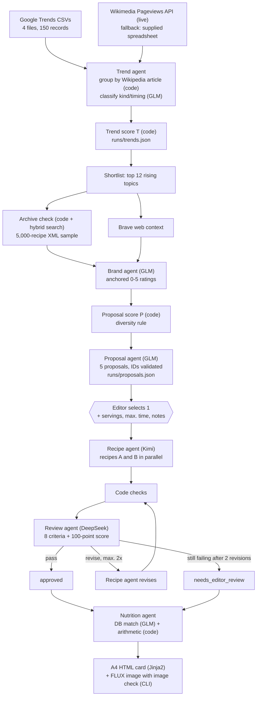
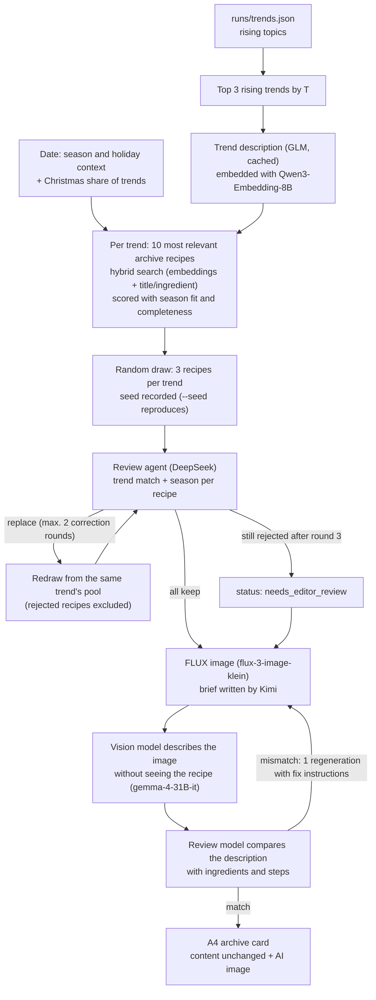

# das schmeckt! Trend-to-Recipe Studio

**OMMAX x Burda Hackathon, Challenge 2: "From Food Trends to New 'das schmeckt!' Recipes"**
Branch `feature/archive-trend-revival`. All numbers below come from the code, the config files and the example outputs in `runs/` and `snapshots/` (as of 20 Nov 2026).

---

## 1. Pitch

The *das schmeckt!* editorial team has to choose recipe topics that are trending now, fit the brand (everyday cooking with high standards, readers around 56, mostly two-person households) and are not already overused in the archive. Today this means reading search data, checking the archive and writing and testing recipes by hand. **Our app is a multi-agent workflow that does the research and the first drafts, while the editor makes the decisions.** It turns Google Trends and live Wikipedia pageviews into five scored, evidence-backed topic proposals. The editor picks one, and the app writes two clearly different recipes, reviews and corrects them against the editorial checklist (with at most 2 correction rounds), calculates nutrition values from the Swiss food database and renders print-ready A4 cards in the *das schmeckt!* design. A second mode, **Archiv-Revival**, takes existing archive recipes that fit current trends and the season and brings them back with new AI images and cards. **What the editorial team gets:** faster topic decisions with evidence attached, drafts that already pass the checklist, transparent nutrition values and a way to reuse the archive, with a person signing off at every step.

---

## 2. Architecture and workflow

| | Mode 1: New-recipe workflow (the brief) | Mode 2: Archiv-Revival (extra) |
|---|---|---|
| Goal | Develop 2 **new** recipes for a trending topic | Bring back **existing** archive recipes that fit current trends and the season |
| Human step | Editor picks 1 of 5 proposals and sets servings, max. time and notes | Editor starts a run (optional seed and image count) and checks items marked „Redaktion prüfen“ |
| Output | `runs/run_<time>_<topic>/` with versioned recipes, reviews, nutrition and A4 cards | `runs/revival_<time>/revival.json`, images and A4 cards |
| UI | Tabs Trends → Vorschläge & Auswahl → Rezepte → Review → Nährwerte → Rezeptkarten | Tab Archiv-Revival |

Design principle: **LLMs judge and write; code counts, scores, validates and calculates.** Every LLM call goes through one gateway client (`services/gateway.py`) that requests JSON. If the reply is not valid JSON, it sends one repair prompt and then tries the fallback model. Every call is logged to `runs/llm_log.jsonl` (model, latency, tokens; no secrets).

### 2.1 Mode 1: New-recipe workflow



### 2.2 Mode 2: Archiv-Revival



The review agent can also put a trend in `retrieve_again`. The code then widens that trend's pool from 10 to 20 recipes before redrawing (`WIDER_POOL = 20` in `agents/revival_agent.py`).

---

## 3. Agents

Model IDs as in `config/models.json`. If a role's model fails, every chat agent falls back to `tesseracted-labs-gmbh/zai-org/GLM-5.3`.

| Agent (file) | Role | Model | Inputs | Outputs | Done in code instead of the LLM |
|---|---|---|---|---|---|
| **Trend agent** (`agents/trend_agent.py`) | Classifies each topic: `kind` (dish, baked_good, ingredient, drink, broad_category, method_or_appliance, diet_or_lifestyle, brand_or_media, non_food), `timing` (current / past_event / evergreen), German name and a one-sentence relevance note | `research`: `tesseracted-labs-gmbh/zai-org/GLM-5.3-Flash` (batches of 30, 2 in parallel) | 150 Google records grouped by Wikipedia article (94 topics) | `runs/trends.json`: 70 eligible candidates, 24 excluded with reasons | CSV parsing (German `1.450 %` → 1450), grouping, live Wikimedia calls, eligibility filter, score T |
| **Trend query writer** (`agents/trend_queries.py`) | One-sentence description per trend for semantic search (e.g. what Spitzbuben are) | `research`: GLM-5.3-Flash (batches of 25) | Topic name + search terms | Cached descriptions; fallback = name + relevance note | Embedding (`embedding`: `tesseracted-labs-gmbh/Qwen/Qwen3-Embedding-8B`, 4,096 dims, with the Qwen3 query instruction) |
| **Brand agent** (`agents/brand_agent.py`) | Rates brand fit (5 dimensions), feasibility (4) and archive gap on an anchored 0–5 scale, each with a reason; can flag `unsuitable` | `brand`: GLM-5.3-Flash (batches of 4) | Brand rules, trend numbers, archive statistics, closest archive recipes, top 3 Brave results | Assessment per candidate | Clamping ratings to 0–5, weighting, B/F/N/P, ranking, diversity rule |
| **Proposal agent** (`agents/proposal_agent.py`) | Writes each of the 5 proposals: title, teaser, trend signal, brand fit, related archive recipes, repetition risk, content gap, **2 different recipe directions**, open questions | `proposals`: GLM-5.3-Flash (2 in parallel) | Evidence block, brand assessment, list of allowed archive IDs | `runs/proposals.json` | Shortlist, scores, selection of the 5; `related_recipes` IDs not in the supplied archive list are removed |
| **Recipe agent** (`agents/recipe_agent.py`) | Writes recipes A and B in parallel (each knows the other's direction); revises a recipe from a review report | `recipe_author`: `tesseracted-labs-gmbh/moonshotai/Kimi-K3.1-Pro` | Proposal, editor spec, closest archive titles (not to be repeated), one archive recipe as style example, JSON format with `group` subheadings and per-step `uses` | `recipe_A_v1.json`, `recipe_B_v1.json`, later versions | Versioning, IDs, status, stripping „Unser Tipp:“ prefix |
| **Review agent** (`agents/review_agent.py`) | Checks against the 8-point editorial checklist + culinary plausibility, gives issues (critical/major/minor) with fixes and 5 sub-scores | `reviewer`: `tesseracted-labs-gmbh/deepseek-ai/DeepSeek-V4.1-Flash` | Recipe JSON, other recipe's title, archive titles, editor spec, **code findings (must be adopted)** | `review_<slot>_v<n>.json` | Deterministic checks (`scoring/recipe_checks.py`), clamping sub-scores, pass rule, loop limit |
| **Nutrition agent** (`agents/nutrition_agent.py`) | (1) proposes Swiss database search terms (Federkohl = Grünkohl, Rahm = Sahne …); (2) picks one DB ID **from a candidate list** per ingredient, with match type and confidence | `nutrition_match`: GLM-5.3-Flash | Ingredient names/notes; candidate lists from the real DB | `nutrition_<slot>_v<n>.json` | Exact matching, candidate search, ID validation, unit → gram conversion, all arithmetic, completeness flag |
| **Image agent** (`agents/image_agent.py`) | Writes a FLUX 3 brief in four steps – finished recipe result → visible ingredients with quantities, per-serving amounts and cooked appearance → final plating from the last step → photography (`config/image_style.md`) – and returns a positive full-scene caption (see 4.8) | Brief: `recipe_author` (Kimi-K3.1-Pro); image: `image`: `flux-3-image-klein` (BFL API) | Recipe (generated or archive) | `.jpg` + `.json` (prompt, seed, cost, model) | Submit/poll/download, saving the job before polling (resumable), bounded regeneration |
| **Image check** (`agents/image_agent.validate_image`, `services/vision.py`) | Vision model describes the image **without the recipe**; review model compares the description with ingredients and steps → match/mismatch + fix instructions | `vision`: `tesseracted-labs-gmbh/google/gemma-4-31B-it` (fallback `vision_fallback`: `tesseracted-labs-gmbh/Qwen/Qwen3-VL-235B-A22B-Instruct-FP8`); comparison: `reviewer` (DeepSeek-V4.1-Flash) | Image (max. 768 px), recipe text | Verdict, missing/wrong/extra, description | Max. 1 regeneration; rejected images kept as `*_rejected1.jpg` |
| **Revival review agent** (`agents/revival_editors.py`) | Per drawn recipe: `trend_match` strong/weak/none, `season_ok`, keep/replace; variety comment; optional `retrieve_again` | `reviewer`: DeepSeek-V4.1-Flash | 9 drawn recipes with trend description, category, season labels, ingredients, method | Review per round in `revival.json` | `trend_match = none` → always `replace` (enforced in code); only per-recipe verdicts decide; unknown trend IDs dropped; redraw and round limit |

---

## 4. Scoring formulas (as implemented)

### 4.1 Trend score T (`scoring/trend_score.py`)

**Percentile:** `p(x) = (average tied rank − 1) / (n − 1)`; `p = 0.5` if n = 1.

**Google part G** – percentiles are computed **inside each Google cohort** (signal type × source kind = rising/top × query/topic), over the records of eligible topics only. A missing increase ("Breakout") counts as growth 0 in the percentile.
```
G = max over the topic's records of [ 0.60 · p(growth) + 0.40 · p(search interest) ]
```
**Wikipedia part W** – percentiles across all candidates with pageviews:
```
log_growth = clip( ln((latest_7d + 20) / (previous_7d + 20)), −ln 4, +ln 4 )     # +20 smoothing, clip at ×4
W = 0.60 · p(latest_7d views) + 0.40 · p(log_growth)
```
**Total:**
```
T = 100 · (0.65 · G + 0.35 · W)
T = 100 · 0.65 · G      if Wikimedia is unknown (note: "score covers 65 of 100 points")
```
- Labels: Wikipedia change > +5 % = growing, < −5 % = declining, otherwise stable.
- Flags: `no_positive_google_growth`, `low_wikipedia_baseline` (previous 7 days < 100 views).
- `is_rising` = best Google growth > 0 (used for the shortlist and the Revival).
- **Eligibility** (before scoring): kind ∈ {dish, baked_good, ingredient, drink}; excluded if the source mapping is flagged for review, if the kind is something else (e.g. broad category, appliance, brand) or if timing is `past_event` (e.g. Halloween).

**Worked example (Grünkohl, `runs/trends.json`):** best record "grünkohl rezept klassisch" +650 %; Wikipedia 3,703 → 3,771 views (+1.8 %). G = 0.868, W = 0.684 →
T = 100 · (0.65 · 0.868 + 0.35 · 0.684) = 100 · (0.564 + 0.239) = **80.4** (rank 1 of 70).
Ranks 2 and 3: Gulasch 79.4, Tiramisu 77.3.

### 4.2 Proposal score P (`agents/proposal_agent.py`, `agents/brand_agent.py`)

Rating anchors for every 0–5 rating (brand agent prompt): **0** = incompatible · **1** = weak · **2** = needs strong adaptation · **3** = acceptable with changes · **4** = strong fit · **5** = strong fit backed by concrete evidence from the supplied data. Each rating needs a reason (max. 20 words). Ratings are clamped to 0–5 in code.

| Component | Formula (0–100) | Weight |
|---|---|---|
| **T** trend | from 4.1 | 0.35 |
| **B** brand | `20 · (0.25·seasonality_regional + 0.25·ingredient_accessibility + 0.20·everyday_practicality + 0.15·culinary_appeal + 0.15·magazine_style)` | 0.30 |
| **N** archive gap (novelty) | `0.5 · coverage_room + 0.5 · (20 · gap_fit)`; `coverage_room = 100 · (1 − p(2·recent title matches + title matches))`, percentile within the shortlist | 0.20 |
| **F** feasibility | `20 · mean(shopping, equipment, effort, recipe_development)` | 0.15 |

```
P = 0.35·T + 0.30·B + 0.20·N + 0.15·F
```
- "Recent" = `DateImported` within the last 730 days of the run date.
- Missing components are left out; ranking uses `P / available_maximum`, and the UI shows "P / max".
- Topics flagged `unsuitable` by the brand agent are excluded.
- Shortlist = top 12 rising candidates by T. **Diversity:** max. 2 `baked_good` and max. 1 `drink` among the 5.

**Worked example (P2 Grünkohl, `runs/proposals.json`):**
B = 20 · (0.25·5 + 0.25·5 + 0.20·4 + 0.15·5 + 0.15·4) = 20 · 4.65 = **93.0**
F = 20 · (5+5+4+4)/4 = **90.0**
Archive: 20 title matches, 11 of them recent → coverage room 45.5; gap_fit 3 → 60 → N = 0.5·45.5 + 0.5·60 = **52.8**
P = 0.35·80.4 + 0.30·93 + 0.20·52.8 + 0.15·90 = 28.1 + 27.9 + 10.6 + 13.5 = **80.1**

The 5 proposals in the example: P1 Engelsaugen 81.7 · P2 Grünkohl 80.1 · P3 Linzer Augen 78.7 · P4 Spitzkohl 77.9 · P5 Gulasch 74.6.

### 4.3 Recipe review score and pass rule (`agents/review_agent.py`, `scoring/recipe_checks.py`)

**Step 1 – code checks (deterministic, before the LLM):**

| Check | Severity | Checklist criterion |
|---|---|---|
| Missing title / ingredients / steps | critical | – |
| Missing introduction, servings, times, serving tip | major | – |
| Ingredient without unique ID | major | – |
| Ingredient without quantity (except salt, pepper, nutmeg, "zum Bestäuben" etc.) | major | 4 |
| Quantity without unit | minor | 6 |
| Step uses an ingredient not in the list | major | 5 |
| Ingredient never used in a step | major | 5 |
| EL vs TL mismatch between list and step | **major** | 7 |
| Other unit mismatch | minor | 6 |
| Split quantities don't add up to the list quantity | major | 6 |
| Step numbers not consecutive | minor | 8 |
| Times missing / total < max(prep, cook) or > prep + cook + 30 | major / minor | – |
| Servings ≠ editor spec; total time > editor's maximum | major | – |
| More than 14 ingredients | minor | brand rule |
| A and B share > 60 % of main ingredients (Jaccard, pantry items excluded) | major | differentiation |
| Title already exists in the archive | major | – |

**Step 2 – LLM review** of the 8 criteria (title, subheadings, plausible quantities, complete quantities, all ingredients used, consistent quantities/units, EL/TL, logical order) plus culinary plausibility, and 5 sub-scores, each clamped in code:

| Sub-score | Max |
|---|---|
| culinary_plausibility | 30 |
| consistency | 25 |
| brand_fit | 20 |
| clarity | 15 |
| differentiation | 10 |
| **Total** | **100** |

**Pass rule:**
```
pass  ⇔  no critical/major finding (code or LLM)
        AND total ≥ 85
        AND NOT (minor findings exist AND version == 1)      # one "polishing" revision for the first draft
```
Otherwise the recipe agent revises it with the full report. After **2 revisions** the loop stops and the recipe is marked `needs_editor_review`.

**Worked example (demo snapshot, Grünkohl run):**
- Recipe A v1: 91/100, no major finding, 3 minor ones → *revise* (polishing rule) → v2: 91/100 → **pass**.
- Recipe B v1: 87/100, 1 major ("850 g root vegetables plus 300 g kale on one tray is too much") → *revise* → v2: 90/100 → **pass**.

### 4.4 Nutrition (`scoring/nutrition.py`, `agents/nutrition_agent.py`, `ingest/nutrition_db.py`, `config/unit_weights.json`)

```
recipe_total[n] = Σ_i grams_i · value_per_100g_i[n] / 100        n ∈ {kcal, kJ, fat, carbs, protein}
per_serving[n]  = recipe_total[n] / servings                      (kcal and kJ rounded to integers, others to 0.1 g)
weight_coverage = grams with a DB match / all grams with a known weight
```

**Matching:** exact name (or "<name>, roh") → LLM search terms → lexical candidates from the real DB (difflib ratio on the name before the comma, +1.0 exact head, +0.6 whole word, +0.3 substring, +0.05 for "roh"; threshold 0.55; top 12) → LLM picks **one ID from that list** (equivalent / closest, confidence high/medium/low). An ID that is not on the list is rejected and the ingredient stays unmatched.

**Unit → gram rules (first matching rule wins, every line records its rule and confidence):**

| Unit | Rule |
|---|---|
| no quantity | Not calculated; salt/pepper "nach Geschmack" are not counted as unresolved |
| g / kg | Taken as is / × 1000 (high) |
| ml / l | × DB density (`Dichte` column, high) → keyword liquids × 1.0 (medium) → oil × 0.92 (medium) → × 1.0 assumed (low) |
| EL / TL | Keyword table: oil 13.8/4.6 g, lard 13/4, butter 15/5, flour/starch/oats 10/3, sugar/salt 15/5, pastes/creams 15/5, ground spices 6/2; liquids 15/5 ml × density; otherwise 15/5 ml × 1.0 (low) |
| weight in the note | e.g. "(ca. 250 g)" → 250 g (high) |
| Stück / Zehe / none | Piece table, e.g. garlic clove 4 g, onion 80, potato 100, carrot 80, apple 150, egg 55, Pinkel 125; otherwise unresolved |
| other | Prise 0.5 g · Bund 30 g (spring onions 100, radishes 150, Suppengrün 300) · Zweig 1 · Stiel 2 · Handvoll 20 · Dose 400 · Scheibe 25 |

**Missing values are never set to zero:** "k.A." stays missing and is listed in `missing_values`. Traces ("Sp.", "<x") count as 0 and are marked as traces. An unresolved ingredient is **major** if its weight is unknown or it makes up ≥ 5 % of the recipe weight. `complete = no major unresolved ingredient`, and otherwise the card says "Unvollständig".

**Worked example (demo run, 2 servings):** "3 EL Rapsöl" → 3 × 13.8 g = 41.4 g (rule "15 ml × 0.92 g/ml"). "2 Stück Pinkel (ca. 250 g …)" → 250 g from the note → matched to *Blutwurst* as *closest, low confidence*. "Kassler" → *Rollschinken* (closest, medium). Result: recipe A 801 kcal / 3,337 kJ per serving, weight coverage 100 %. Recipe B 727 kcal / 3,023 kJ, coverage 99.3 %.

### 4.5 Hybrid archive search (`scoring/hybrid.py`, `ingest/archive_vectors.py`)

- **Document text per recipe:** title, subtitle, category, editorial labels, up to 12 main ingredients (pantry staples removed) and the first 240 characters of the method, embedded once with Qwen3-Embedding-8B (L2-normalised, cosine = dot product). Cached in `runs/cache/` and built in checkpoints of 320 recipes.
- **Query:** the LLM trend description (trend query writer, section 3), embedded with the Qwen3 query instruction.

```
sim       = cosine(query, recipe)
sem       = clip( (sim − P99(sim)) / (max(sim) − P99(sim)), 0, 1 )      # calibrated per trend: 99th percentile → 0, best → 1
lex       = 1.0 title/subtitle match · 0.4 ingredient match · 0
relevance = 0.6 · sem + 0.4 · lex
```
- Lexical terms: topic name, Wikipedia article and query terms, lower-cased, with "rezept/klassisch" removed and simple plural variants (min. 4 characters).
- **Keyword hits are always kept** (the semantic part re-ranks them).
- **Semantic-only hits** need `sem ≥ 0.5` **and** raw `sim ≥ 0.5`; at most **10** per trend, relevance = 0.6 · sem.
- **Fallback without vectors:** relevance = 1.0 (title) / 0.4 (ingredient), labelled "lexical only".
- In the proposals' archive check, the **counts stay lexical** (comparable repetition statistics). Hybrid hits only fill "closest recipes" and, if there is no keyword hit, the "most recent comparable recipe" (semantic hits with relevance ≥ 0.5).

### 4.6 Season fit (`scoring/season.py`)

**Date weights** (labels as stored in the archive field `CustomRecipeThesaurs`): the current season gets 1.0. Additional rules:
- November: Winter 0.8, or 1.0 from the 15th.
- February: Frühling 0.5. August: Herbst 0.4.
- 1 Nov–24 Dec: Advent = 1.0 from the 1st Sunday of Advent, before that max(0.6, 1 − days_to_advent/30). Weihnachten = 1.0 in December, before that max(0.6, 1 − days/40). Geschenke aus der Küche 0.6.
- Silvester/Neujahr: 1.0 from 20 Dec to 2 Jan, otherwise 0.3 in December and from 15 Nov.
- Halloween: 0.8 in October, 0.2 on 1–2 Nov. Ostern: 0.7 in Mar/Apr. Summer months: grilling/BBQ 0.9, Sommerparty/Eis 0.8.

**Trend boost:** if ≥ 15 % of the rising trends' T-mass comes from Christmas specialities (Lebkuchen, Vanillekipferl, Spitzbuben …), Advent and Weihnachten get +0.3 (capped at 1.0).
**Off-season labels:** for every season with weight ≥ 0.8, its clashing labels (e.g. Sommer, Grillen, Ostern, Eis in autumn/winter), minus labels that are in season.

```
season_fit(recipe) = max weight of the recipe's in-season labels       (Christmas-flagged recipes count as "Weihnachten")
                   = 0.0  if it only has off-season labels
                   = 0.4  if it has no season label
```
**Example (20 Nov 2026, `runs/revival_20261120_162851`):** 1st Advent = 29 Nov → Advent max(0.6, 1 − 9/30) = 0.7, Weihnachten max(0.6, 1 − 9/40) = 0.775. The Christmas share of the rising trends is 23 % (≥ 15 %), so both get +0.3 → 1.0. Final weights: Herbst 1.0, Winter 1.0, Advent 1.0, Weihnachten 1.0, Geschenke aus der Küche 0.6, Silvester/Neujahr 0.3. Off-season: Eis, Frühling, Grillen, Grillparty/BBQ, Ostern, Sommer, Sommerparty.

### 4.7 Archiv-Revival pool score and random draw (`scoring/revival.py`, `agents/revival_agent.py`)

```
trend_relevance = T/100 · hybrid relevance
completeness    = share of 4 checks: ≥ 2 steps · servings given · a time given · ≥ 3 ingredients
pool score      = 100 · (0.55 · trend_relevance + 0.35 · season_fit + 0.10 · completeness)
```
- **Pool:** per trend (top 3 rising by T) the **10** best recipes by pool score, duplicate titles removed (`revival_pool_size` = 10). The publication date is deliberately ignored.
- **Draw:** `random.Random(seed).sample(pool, 3)`, a uniform draw without replacement (`revival_per_trend` = 3). If no seed is given, a new 32-bit seed comes from `SystemRandom`, so each run brings different recipes. The seed is saved in `revival.json`, and `--seed N` (or the seed field in the app) reproduces the run.
- **Review loop:** recipes marked `replace` are excluded, and replacements are drawn from the **same trend's pool** (excluding rejected and kept recipes). There are at most 2 correction rounds (3 reviews in total). Anything still rejected after that gets `needs_editor_review`.
- **Images** only for the first `revival_max_images` items (config: **2**, a test limit; the app allows 0–9, about 0.9 credits each).

**Worked example (`runs/revival_20261120_162851`, seed 3483016102):** "Szegediner Gulasch" is a title match with sem = 1.0, so relevance = 0.6 · 1.0 + 0.4 · 1.0 = 1.0 and trend_relevance = 0.794 · 1.0 = 0.794. It has no season label (fit 0.4) and is complete (1.0):
score = 100 · (0.55 · 0.794 + 0.35 · 0.4 + 0.10 · 1.0) = **67.7** (rank 3 in the Gulasch pool).
"Italienisches Tiramisu": sem 0.931 → relevance 0.959 → trend_relevance 0.741; label Weihnachten (fit 1.0) → **85.8** (rank 1 in the Tiramisu pool).
In this run the review agent kept all 9 drawn recipes in round 1. It marked `variety_ok = false` (two near-identical Lebkuchen tiramisus), but that does not trigger a redraw: variety is informational only.

---

### 4.8 FLUX 3 image prompt (`agents/image_agent.py`, `services/flux.py`)

Images come from **FLUX 3 Image Klein** (`flux-3-image-klein`, 1024 × 1024, ~6 s, 0.9 credits). The prompt is written by
the recipe model (Kimi-K3.1-Pro) from the **final** recipe version, in a fixed order so that photography never changes
what the recipe says:

| Step | Content | Done in code vs. LLM |
|---|---|---|
| 1. Recipe result | One sentence: which complete dish, which cooked states, one plated serving or a whole family-style dish | LLM |
| 2. Ingredients and proportions | Each visible ingredient with real-life cooked appearance (colour, surface, cut) and its **quantity – total and per serving** as a visual proportion anchor; leafy greens shrink when braised, grains swell; no invented counts or cut sizes | **Per-serving amounts calculated in code** (`ingredient_context`, `archive_ingredient_context`; ranges and unknown servings stay explicit) |
| 3. Final plating | Base, toppings, accompaniments, layer order and vessel from the last step(s); styling may not reverse layers or add garnish | LLM, based on the recipe's last step |
| 4. Photography | Cover style from the brand guide's top covers (`config/image_style.md`): high angle 60–75°, food fills the frame, bright natural daylight, calm warm-neutral background, true colours | LLM |

- **Positive full-scene caption, max. 220 words:** FLUX 3 Klein runs its own prompt upsampler (always on via the API),
  so the brief describes exactly what is in the photo instead of listing exclusions.
- **German names are described, not named** (e.g. Pinkel → "pale grey-beige simmered grain sausage"), because the
  image model does not reliably know regional foods.
- **Provenance** saved next to every image: prompt, recipe result, ingredient context with quantities, final plating,
  all recipe instructions, seed, job ID, credits, model.
- **Image check (both modes):** the vision model (gemma-4-31B-it) describes the image without seeing the recipe; the
  review model compares the description with ingredients and steps → `match` / `mismatch` with missing, wrong and extra
  items and fix instructions → at most **1 regeneration**; still wrong → "Redaktion prüfen". Rejected images are kept.
- **Live example (Grünkohl-Eintopf, new prompt):** attempt 1 was rejected (sausages browned as if fried, although the
  recipe simmers them; stray lettering), attempt 2 fixed the sausages but showed whole kale leaves with thick stems
  instead of wide strips → marked „Redaktion prüfen“, 1.8 credits. The check caught real deviations; FLUX does not always
  follow detailed cut and cooking instructions.
- Prompt design credit: the recipe-scaled FLUX 3 prompt was contributed by a teammate (commit `c3d0d2a`).

## 5. Data sources

| Source | What it is | How it is used |
|---|---|---|
| **Google Trends** (4 CSVs, DE, 18 Oct–18 Nov 2026) | Top/rising × queries/topics, 150 records | Grouped into 94 topics via the supplied term → Wikipedia mapping; growth and interest percentiles per cohort → G |
| **Wikimedia Pageviews API (live)** | de.wikipedia.org, `all-access/all-agents`, descriptive User-Agent | Two 7-day windows ending yesterday (example run: 6–12 Nov vs 13–19 Nov) → W. Days missing from the response (and a 404) count as 0 views (documented API behaviour). Per-article fallback to the supplied spreadsheet if the call fails; live and fallback series are never mixed within one article. The example run used live data for all 94 topics. Cached in `runs/cache/wikimedia/` |
| **Brave Search API** | Web results, DE, German, last month (`freshness=pm`), 5 results | Context only (shown as evidence; top 3 go to the brand agent), not counted in any score. Cached |
| **Recipe archive** (5,000 XML files + `rezepte_export_topicmap.sql` + `auswahl_manifest.json`) | Category-stratified sample of 81,798 recipes | Parsed per the archive README (group order kept, missing values stay missing, SQL dump parsed as text, never executed). Ingredient/unit names resolved via the topic map. Category and Christmas flag (500 recipes) from the manifest. Editorial labels from `CustomRecipeThesaurs` (3,354 recipes have labels). Used for the archive check, the style example, duplicate titles, hybrid search, Revival and card tests |
| **Swiss Food Composition Database V 7.1** (generic foods, CSV) | 1,216 foods, values per 100 g edible portion, density column | Nutrition matching and calculation (4.4) |
| **Brand guide** (`MarkenCI_das schmeckt.pdf`) → `config/brand_rules.md` | Target group, interests, expectations, cover hypotheses | In the prompts of the brand, recipe, review and revival review agents |
| **Cover analysis** (brand guide p. 4 "Top 10 Cover", CPI +9.4 % to +22.2 %; p. 5 "Low 10 Cover", CPI −9.9 % to −24.6 %) → `config/image_style.md` | Visual rules: hearty, golden-brown, in the cooking vessel with a serving spoon, 60–75° angle, calm warm background; avoid large green areas, strong background colours, berry cakes | Image brief system prompt. The covers themselves are **not** passed to FLUX (it is an editing model and would copy logos and headlines) |
| **HTML template** (`challenge-2/templates/…Recipe-Preview-A4.html` + requirements) | Salmon example | Its CSS, logo, colours and section headings are reused in a flowing A4 layout (`rendering/card.py`, Jinja2). Pagination happens in Python (no JavaScript), with header, footer and "Seite x von y" on every page. The same renderer shows archive XML recipes unchanged |
| **Recipe Review Criteria.docx** | 8-point checklist | Review agent criteria + code checks |

---

## 6. Quality and safety guardrails

| Guardrail | Implementation |
|---|---|
| **Human selection** | The editor chooses 1 of 5 proposals; name, servings, max. time and notes are saved in `selection.json` with a timestamp. Nothing is published automatically |
| **Bounded loops** | Recipe review: max. 2 revisions → `needs_editor_review`. Revival review: max. 2 correction rounds. Image check: max. 1 regeneration. Gateway: 1 JSON repair + 1 fallback model |
| **Validated IDs** | Archive IDs in proposals must come from the supplied list; nutrition DB IDs must come from the candidate list; revival trend IDs in `retrieve_again` must exist |
| **LLM judges, code counts** | All weights, totals, percentiles, nutrition arithmetic and unit conversions are in code; LLM ratings are clamped to their ranges; `trend_match = none` forces `replace` |
| **No invented nutrition values** | The LLM only picks DB entries; missing values are not treated as zero; every gram value names its rule; major unresolved ingredients make the label "Unvollständig"; cards say "Schätzwerte, keine Labormessung" |
| **Transparent AI content** | Cards say „KI-generierter Rezeptentwurf“; images are captioned „KI-generierte Illustration · kein Originalfoto“; archive content is shown unchanged |
| **Escaping** | Jinja2 autoescape for all card content (test `test_llm_text_is_escaped`) |
| **Version consistency** | Cards are only exported when review and nutrition exist for the **current** recipe version; images are tied to a recipe version |
| **Secrets** | Keys only in `.env` (git-ignored; `.env.example` has empty placeholders); the LLM log stores no secrets |
| **Resilience / backup** | Caches for Wikimedia, Brave, embeddings and trend descriptions; FLUX jobs saved before polling; `snapshots/demo_backup_2026-11-20` (trends, 5 proposals, complete Grünkohl run). Restoring backs up current files to `runs/_backup_<time>/` first |
| **Tests** | 29 unit tests (see section 10) |

---

## 7. Demo script (~5 minutes)

Start: `streamlit run app.py`. For a demo without live APIs, open **Sidebar → "Demo-Backup (Snapshot)" → `demo_backup_2026-11-20` → "Snapshot laden"**.

| Time | Tab | What to show and say |
|---|---|---|
| 0:00–0:30 | – | Problem and pitch (section 1). Two modes, the editor stays in control |
| 0:30–1:15 | **Trends** | 70 scored candidates from 150 Google records + live Wikipedia. Grünkohl at the top (T 80.4). Open "Ausgeschlossen (24)" to show that generic, appliance and past-event topics are filtered out with reasons. Point to the formula caption and the limitations |
| 1:15–2:15 | **Vorschläge & Auswahl** | 5 proposals with P and T/B/N/F. Open P2 Grünkohl (80.1): archive statistics (20 title matches, 11 recent), most recent comparable recipe, brand ratings with reasons, Brave context, 2 recipe directions. Show the selection form (servings, max. time, editor name) |
| 2:15–2:45 | **Rezepte** | Recipes A and B (one-pot stew vs. oven tray), status badges, run event log |
| 2:45–3:30 | **Review** | A: 91 points but minor findings → polishing revision → v2 passes. B: major finding (tray overloaded) → v2 passes with 90. Show the checklist and the "Änderungen v1 → v2" diff |
| 3:30–4:00 | **Nährwerte** | Per-serving values; table with DB entry, match type, confidence and gram rule (Kassler → Rollschinken, closest; Pinkel → Blutwurst, low). Unresolved items are listed, not hidden |
| 4:00–4:20 | **Rezeptkarten** | A4 card in the das schmeckt! layout, AI label, nutrition box, download. Expander: the same template renders an archive recipe (e.g. "Rosenkohl") |
| 4:20–5:00 | **Archiv-Revival** | Season context line. Pick a saved result: show the seed, the pool per trend with drawn items marked 🎲, the review rounds and, for items with images, "Bildprüfung im Detail" (blind image description → match). Mention that the same seed reproduces the run and a new run gives new recipes |

Notes for the presenter:
- The snapshot's run was made by editor `cli-test`. TASKS.md recommends saving the editor's real run with `python -m storage.snapshot save <name> <run_id>`.
- **Revival results are not part of the snapshot** (they live in git-ignored `runs/revival_*`). Make sure one exists on the demo laptop; `runs/revival_20261120_162027` has 2 checked images (both "match"), though it was made with the earlier selector design, while `runs/revival_20261120_162851` is a new-flow run without images.
- A live Revival run needs the gateway (embeddings, review) and, for images, the BFL key. Set images to 0 for a quick run.

---

## 8. Honest limitations

- **Archive sample:** 5,000 of 81,798 recipes (category-stratified), so all archive statements hold "in this sample". Editorial labels exist for 3,354 of them.
- **Dates:** "most recent comparable recipe" and "recent" use `DateImported` (CMS import date), not the print date.
- **Trend data:** fixed Google snapshot (18 Oct–18 Nov 2026), normalised 0–100 values rather than counts (a rising "0" is a rounded small value). The Google and Wikipedia windows differ. The November rise is partly seasonal (Advent/Christmas baking), so it is not necessarily a lasting trend. Scores are relative rankings within this dataset. Several search terms can share one broad Wikipedia article. The trend and brand prompts hard-code the current period and date (20.11.2026).
- **LLM judgements:** brand, feasibility and gap ratings are LLM judgements against the brand guide, not reader research. The AI review does not replace a test kitchen.
- **Nutrition:** database estimates, not lab values. Cooking losses are ignored. Piece and spoon weights are kitchen conventions. Some matches are "closest substitutes" (e.g. Pinkel → Blutwurst, low confidence).
- **AI images:** illustrations, not original photos (the archive export has none). FLUX can show wrong components.
- **Image check can miss details:** it compares a *text description* of the image with the recipe. It caught a known faulty Tiramisu image (ladyfingers on top instead of cocoa-dusted cream, per REVIVAL-PLAN.md), but it is not a pixel-level check. Both modes now run this check: in the new-recipe workflow images are created via CLI (`python -m agents.image_agent <run_id> <slot>`, no app button yet), in the Revival automatically.
- **FLUX upsampler:** the BFL API always runs the prompt upsampler and it cannot be switched off (`prompt_upsampling`, `upsampling`, `pup` are rejected with HTTP 422). A comparison with and without it would need the open weights and a GPU.
- **Revival:** the draw within the pool is random by design, so quality varies within the top 10. Variety across the drawn recipes is only commented on, not enforced. Images are limited to 2 per run by default (test limit).
- **Hybrid search calibration** (99th percentile, 0.5 thresholds) was set by inspecting raw scores (e.g. Rosenkohl), not by a labelled evaluation.

---

## 9. Costs: search and credits

Figures measured on 20 Nov 2026 (about 16:35). LLM token numbers are computed from `runs/llm_log.jsonl`. No euro prices are given where no price list is known.

| Service | Unit | Measured usage | Notes |
|---|---|---|---|
| **BFL / FLUX** (`flux-3-image-klein`) | Credits | **0.9 credits per image** (`cost` in the API response, stored as `cost_credits`). 20 generations with recorded metadata in `runs/` = **17.1 credits** | Earlier `flux-2-pro` test jobs reported no cost. **The account balance (1,567,176.93 → 1,564,898.99 credits, −2,277.94) is *not* our cost:** the key was handed to all participants via QR code, so the account is very likely shared between teams. The per-job cost is the reliable figure |
| | Per run (estimate) | New-recipe workflow: 2 images ≈ **1.8 credits** (up to 3.6 with 1 regeneration each). Archiv-Revival: images for all 9 recipes ≈ **8.1** (up to 16.2); with the current limit of 2 images ≈ **1.8** | |
| **Tesseracted gateway** (LLMs) | Tokens (no price list known) | **93 logged calls, 164,025 prompt + 494,279 completion tokens** (all runs on 20 Nov) | Completion tokens are high because all chat models are reasoning models |
| **Embeddings** (Qwen3-Embedding-8B) | Tokens (estimate, not logged) | Archive index built once: 5,000 recipes × ~475 characters ≈ **0.6–0.7 M input tokens**, plus an interrupted first attempt of ~2,900 recipes; query embeddings are tiny | Not in `llm_log.jsonl` |
| **Vision** (gemma-4-31B-it) | Calls (not logged) | ~4 s per image check | Not in `llm_log.jsonl` |
| **Brave Search** | Requests (plan of the supplied key unknown) | **12 searches** (one per shortlisted topic in one proposal run) + 1 connectivity test | Cached in `runs/cache/brave`; reruns cost 0 requests |
| **Wikimedia API**, **Google Trends files** | – | Free | Wikimedia only needs a descriptive User-Agent |

**LLM tokens by phase** (sums over all runs of the day, including failed attempts; the phases add up to the totals above):

| Phase (log agents) | Calls | Prompt tokens | Completion tokens |
|---|---|---|---|
| Trends + proposals (`trend`, `trend_queries`, `brand`, `proposal`) | 18 | 24,289 | 115,011 |
| New recipes, review, nutrition (`recipe*`, `review_*`, `nutrition_*`; nutrition was run 3 times) | 24 | 46,070 | 88,322 |
| Image briefs + checks, new-recipe workflow (`image_brief`, `image_check`) | 14 | 18,788 | 67,336 |
| Archiv-Revival (`revival_image`, `revival_review`, `revival_selector`) | 34 | 74,588 | 223,295 |
| Gateway smoke tests (no agent name) | 3 | 290 | 315 |
| **Total** | **93** | **164,025** | **494,279** |

Biggest consumer: **Revival image briefs** (Kimi-K3.1-Pro), with 26 calls and 186,210 completion tokens. 15 of those 26 calls ended with "invalid JSON, finish=length", meaning the reasoning used up the 8,000-token budget and the gateway client had to repair or fall back. **Fixed:** the image-brief budget is now 16,000 tokens.

**Time as a cost:** trend agent ~80 s · proposals ~2 min 15 s · recipes ~100 s · review loop ~1–3 min · nutrition ~15 s · image ~6 s FLUX + ~30–60 s brief · archive vector index ~17 min (once).

**How we keep costs down**
- **Caching:** Wikimedia, Brave, trend descriptions, the archive index and the archive embeddings are cached in `runs/cache/`, so reruns don't repeat paid calls.
- **Limits:** image test limit `revival_max_images` = 2 (`config/models.json`; adjustable in the app, 0–9); images are generated on request, not automatically, in the new-recipe workflow.
- **Bounded loops:** max. 1 image regeneration, max. 2 recipe revisions, max. 2 revival correction rounds, 1 JSON repair + 1 fallback model per call.
- **No double payment:** the FLUX job ID is saved before polling, so an interrupted job can be resumed instead of paid for again. One job was lost before this fix.
- **Snapshots:** the demo runs from `snapshots/demo_backup_2026-11-20` with no live API calls.

---

## 10. Tech stack, how to run, tests

**Stack:** Python 3.12 · Streamlit (UI) · requests · pandas · openpyxl (Wikimedia fallback xlsx) · Jinja2 (cards) · numpy (vectors) · python-dotenv · Pillow (image resize for vision) · pytest. Model access goes through the Tesseracted Labs OpenAI-compatible gateway (chat, embeddings, vision, streaming). Images come from the Black Forest Labs API, plus the Brave Search API and the Wikimedia REST API. Workflow state is kept in JSON files per run (`runs/<run_id>/`), with no database.

**Setup and run**
```
python -m venv .venv
.venv\Scripts\activate
pip install -r requirements.txt
copy .env.example .env        # TESSERACT_BASE_URL, TESSERACT_API_KEY, BRAVE_SEARCH_API_KEY, BFL_API_KEY
streamlit run app.py
```

**CLI equivalents**
```
python -m agents.trend_agent                    # -> runs/trends.json
python -m ingest.archive_vectors                # build the archive embedding cache once
python -m agents.proposal_agent                 # -> runs/proposals.json
python -m agents.recipe_agent    <run_id>       # run_id is created by the editor's selection in the app
python -m agents.review_agent    <run_id>
python -m agents.nutrition_agent <run_id>
python -m agents.image_agent     <run_id> <A|B> # FLUX image + image check for a generated recipe
python -m agents.revival_agent [--seed N] [--no-images]   # -> runs/revival_<time>/
python -m storage.snapshot list | save <name> [run_id ...] | restore <name>
```

**Tests:** `.venv\Scripts\python -m pytest -q` → **38 passed** (20 Nov 2026). They cover German number parsing, percentiles, Wikipedia labels, all 150 Google records, recipe checks (unused/unknown ingredients, split quantities, EL/TL, missing quantities, servings and pair similarity), nutrition conversions and a hand-checked calculation, card rendering/pagination/escaping, hybrid calibration and lexical fallback, season calendar and Christmas boost, revival ranking, forced replace on `trend_match = none`, bounded image regeneration, a seeded, reproducible draw that respects exclusions, a failed review never counting as approval, the proposal agent's imports, the FLUX service payload and the image agent's per-serving quantity context.

**Typical run times (from TASKS.md):** trends ~80 s · proposals ~2 min 15 s · recipes ~100 s · review 1–3 min · nutrition ~15–20 s · FLUX image ~6 s (0.9 credits). The archive embedding index is built once: ~17 min measured (depends on gateway speed).
