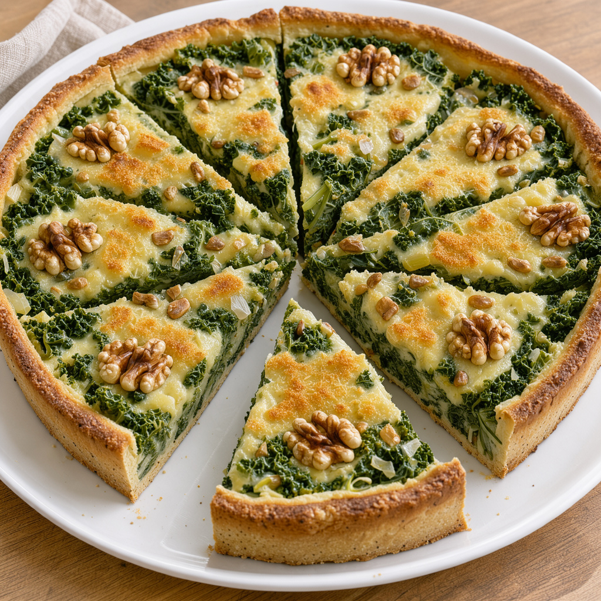
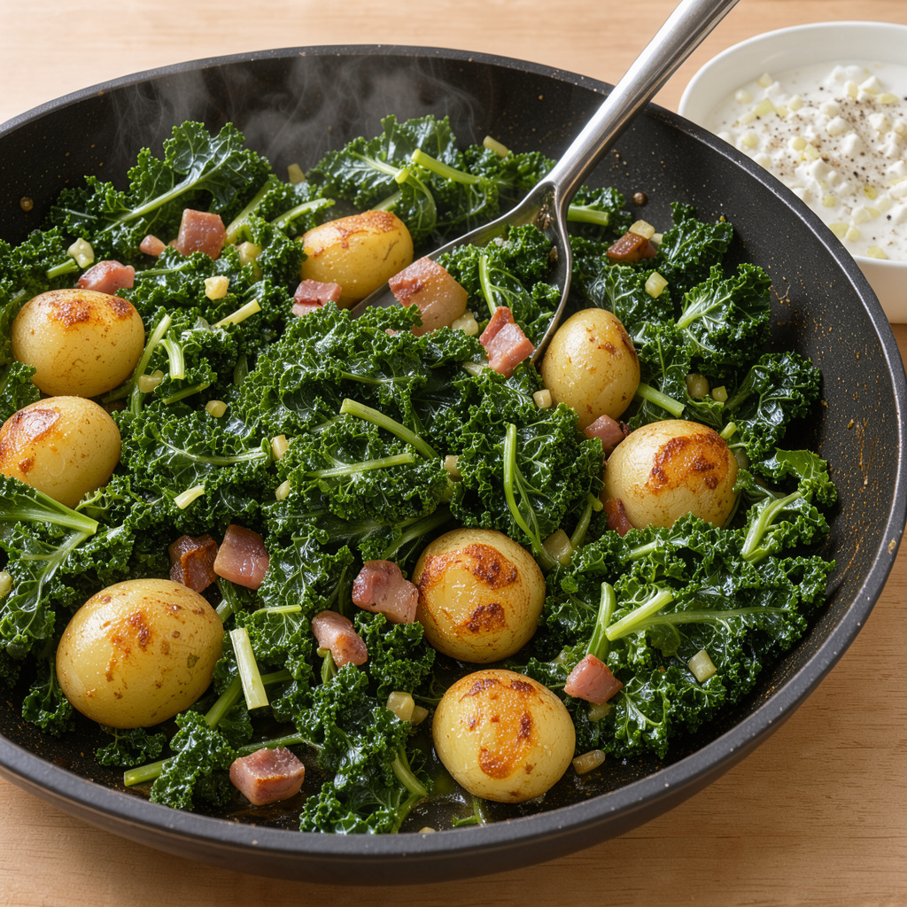
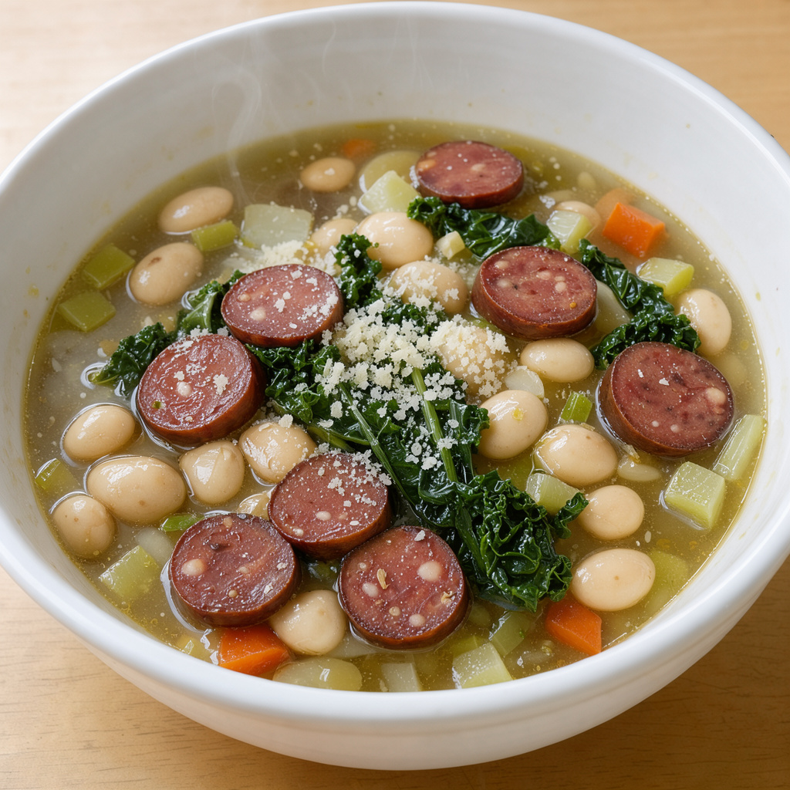
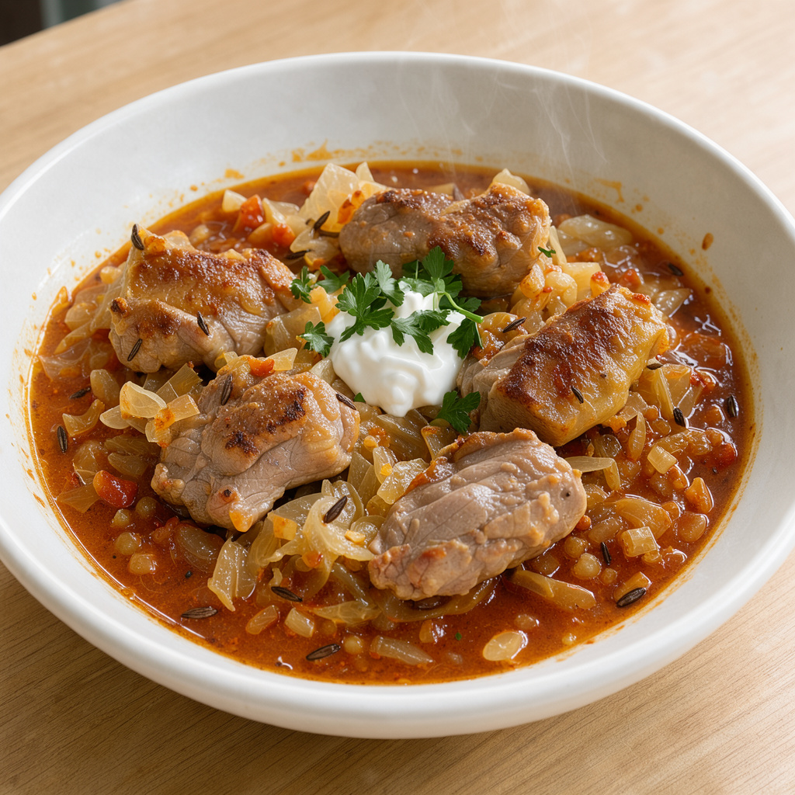
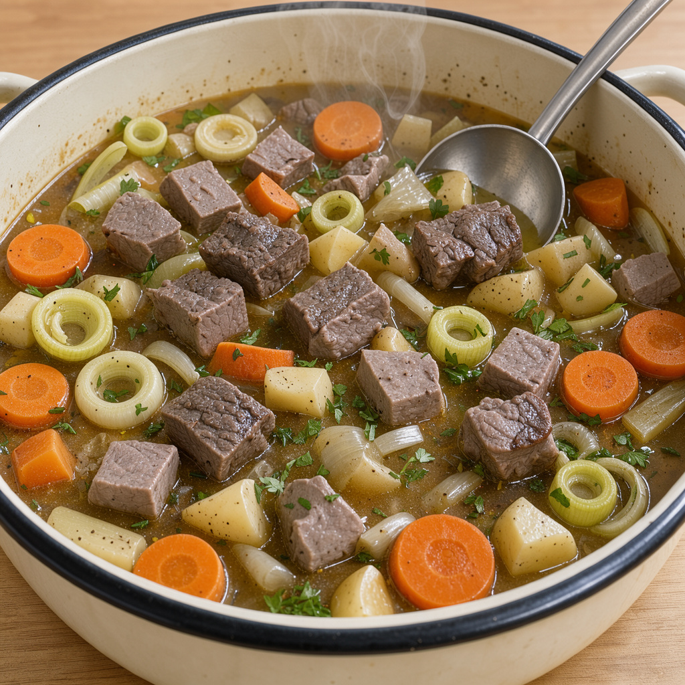
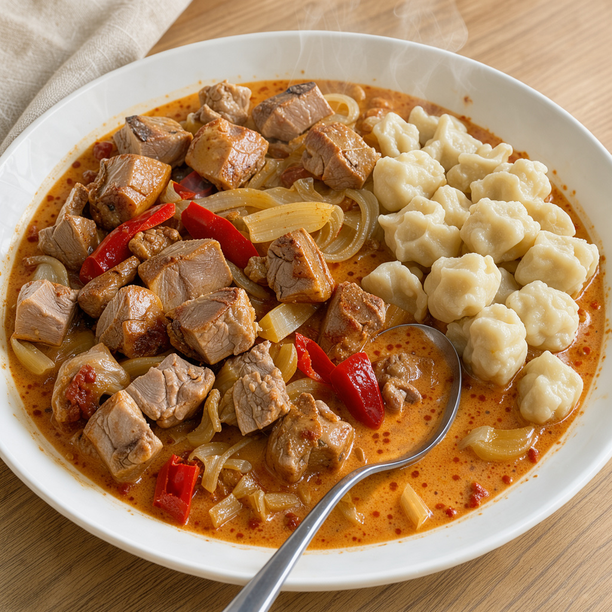
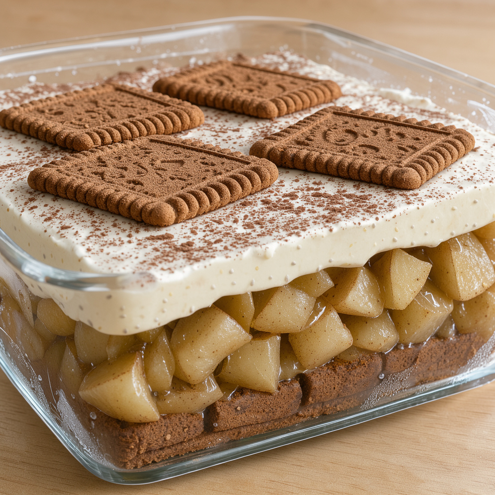
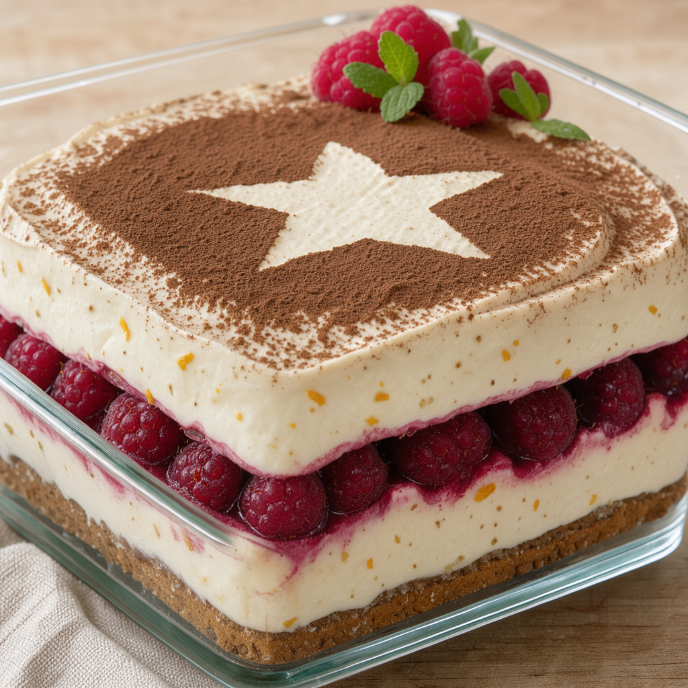
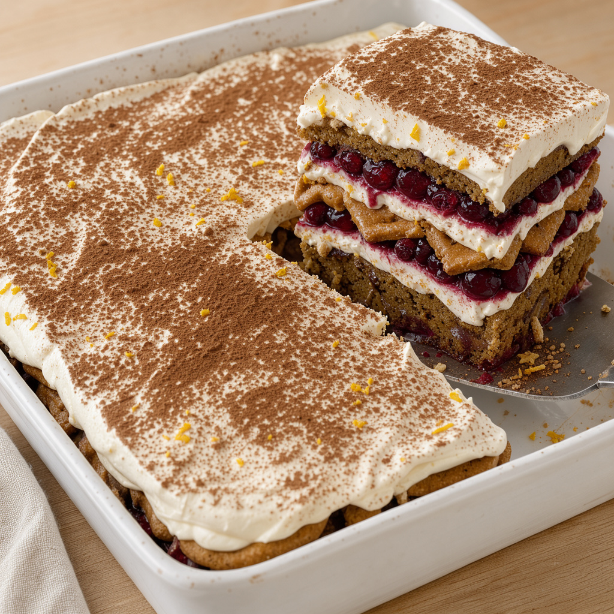

# Bilder + Karten – Top-3-Trends (revival_20261120_164716)

- **Rezepte:** aus `results/revival_20261120_164716` (Seed `385792274`), je Trend 3 zufällig gezogene Archivrezepte
- **Bildmodell:** FLUX 3 Image Klein (`flux-3-image-klein`), 1 Bild je Rezept
- **Bildprüfung:** **aus** – Bilder sind ungeprüft (auf Wunsch übersprungen)
- **Credits:** 8.1

## Grünkohl

| Rezept | Bild | Karte | Status |
|---|---|---|---|
| Grünkohl Quiche |  | [Karte](01_gr-nkohl-quiche.html) | unchecked |
| Grünkohlpfanne |  | [Karte](02_gr-nkohlpfanne.html) | unchecked |
| Winter-Minestrone mit Grünkohl |  | [Karte](03_winter-minestrone-mit-gr-nkohl.html) | unchecked |

## Gulasch

| Rezept | Bild | Karte | Status |
|---|---|---|---|
| Szegediner Gulasch |  | [Karte](04_szegediner-gulasch.html) | unchecked |
| Pichelsteiner Eintopf mit Steakwürfeln |  | [Karte](05_pichelsteiner-eintopf-mit-stea.html) | unchecked |
| Schweine-Rahm-Gulasch |  | [Karte](06_schweine-rahm-gulasch.html) | unchecked |

## Tiramisu

| Rezept | Bild | Karte | Status |
|---|---|---|---|
| Spekulatius-Apfel-Tiramisu |  | [Karte](07_spekulatius-apfel-tiramisu.html) | unchecked |
| Spekulatius-Tiramisu |  | [Karte](08_spekulatius-tiramisu.html) | unchecked |
| Lebkuchen Tiramisu |  | [Karte](09_lebkuchen-tiramisu.html) | unchecked |

Die Bilder sind KI-Illustrationen (keine Originalfotos); Rezeptinhalte auf den Karten sind unverändert aus dem Archiv.
